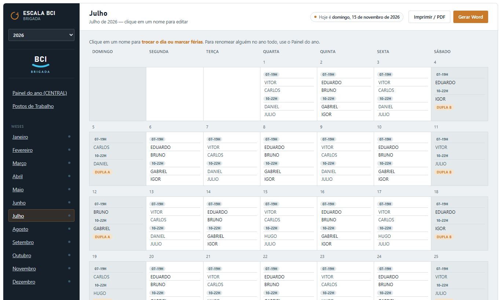
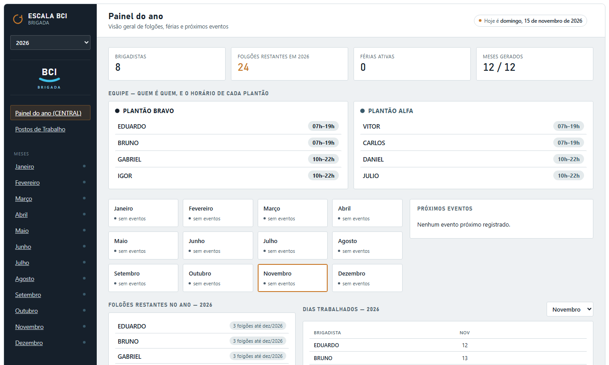
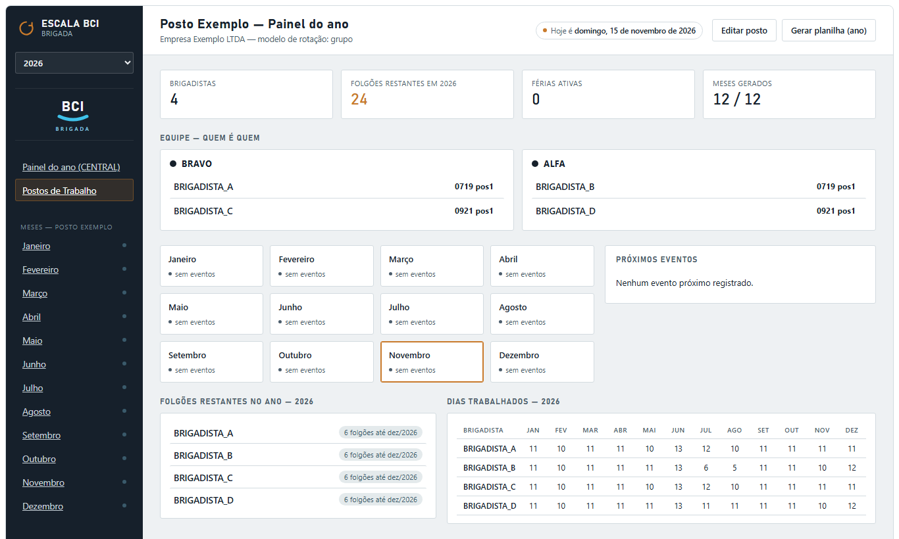
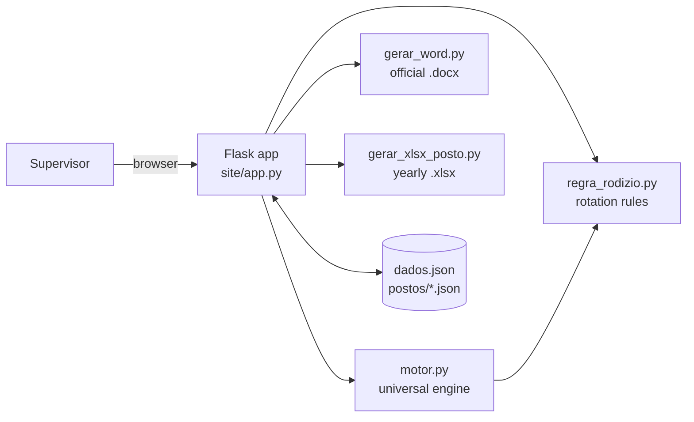

# Escala BCI — shift scheduler for fire brigades

> 🇧🇷 **Resumo:** ferramenta que gera a escala mensal de plantões de uma brigada contra incêndio. Antes, o chefe montava tudo à mão no Word todo mês. Hoje ele abre um `.exe`, clica e baixa o documento oficial pronto. Construído por iniciativa própria, com IA (Claude Code), e em uso real desde julho de 2026.



## The problem

My supervisor at the fire brigade spent hours every month building the shift schedule by hand in Word: who works each day, the 12x36 rotation, weekends, days off, vacations and substitutes.

Nobody asked me to fix it. I watched how he did it, asked what he needed, and built the tool.

## What it does

- **Calculates the rotation** for any month or year from a single anchor date, with no manual counting. The rules follow Brazilian Law 11.901/2009 (12x36 brigade shifts).
- **Handles real exceptions:** swapped days, vacations with a substitute, weekend rules, training certificate codes.
- **Generates the official Word document** in the exact layout he already used (landscape, one page), plus a printable PDF view.
- **Supports several workplaces** ("postos"), each with its own number of shifts, positions and rotation model.
- **Runs anywhere:** packaged as a single Windows `.exe`. He copies one file and it works, with nothing to install.

| Year dashboard | Generic workplace |
|---|---|
|  |  |

An example of a generated document: [`docs/exemplo-escala-julho-2026.docx`](docs/exemplo-escala-julho-2026.docx).

## Impact

- Adopted by my supervisor in July 2026 and still in use ("está funcionando perfeitamente").
- The calculation was **validated against the real official schedules, with 0 differences**. The weekend rule of the second workplace was checked cell by cell against 16 real weekends.
- ⏱️ **Time saved:** a monthly document that took hours by hand in Word now takes one click.

## How I built it (with AI)

I built it with **Claude Code** as my pair programmer, in a planned, test-first way:

1. **Discovery:** I sat with the real documents and wrote down every rule, including the strange ones (for example, which position covers Sunday).
2. **Spreadsheet first:** a living Excel file and a Word generator, validated against past schedules before any website existed.
3. **Mockup, then code:** [`mockup-referencia.html`](mockup-referencia.html) was reviewed over several rounds before becoming the Flask app.
4. **Tests against real data:** the rotation engine has regression tests that compare the output with the official schedules.
5. **Generalisation:** once one workplace was right, I extracted a "universal engine" (`scripts/motor.py`) that turns the workplace structure into parameters.
6. **Hardening:** file locks against concurrent writes, and sensitive data kept out of the repository.

37 commits between 15 and 23 July 2026.

## Architecture



| Part | Tech |
|---|---|
| Web app | Python, Flask, Jinja templates, vanilla JS/CSS |
| Documents | python-docx (Word), openpyxl (Excel) |
| Storage | JSON files + `filelock` |
| Tests | pytest (42 tests) |
| Distribution | PyInstaller (single `.exe`) |

## Run it

```bash
pip install -r requirements.txt
python site/app.py          # opens on http://127.0.0.1:5000
python -m pytest -q         # 42 tests
```

On the first run the app copies `dados.example.json` (fictitious team) to `site/dados.json`.

To build the Windows executable: double-click `Construir Exe.bat`.

## Privacy

All names, companies and places in this repository are **fictitious**. The real team data never leaves my supervisor's computer (`dados.json` and `postos/*.json` are in `.gitignore`).

## What I learned

- Writing down the rules with the real user before coding saved more time than any code optimisation.
- Testing against real past documents is what made the user trust the tool.
